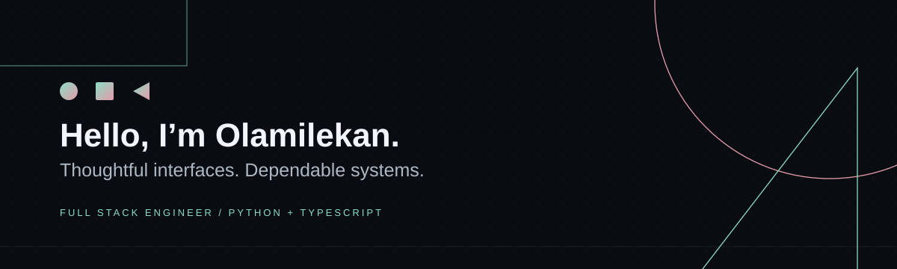

## 👋 A bit about me

- I’m **Aleshinloye Olamilekan**, a full stack engineer based in Ibadan, Nigeria, with a strong backend focus.
- I build web and mobile products, payment systems, multi-tenant platforms, and developer tools with **Python and TypeScript**.
- At **Kenkeputa**, I work on VendorizeMe’s marketplace, mobile features, payments, and native search. At **Xeta Digital**, I build visitor-management systems and the APIs behind them.
- Creator of [pytest-authz-matrix](https://github.com/Leanstix/pytest-authz-matrix), an open-source tool for testing API authorization.
- I built the ML and intelligence layers for **Lafiya**, our **HealthTrace Hackathon 2026-winning** project.
- Studying Computer Science at the **University of Ibadan**. Outside engineering: poker, history, and human intellectual development.
- Open to remote engineering roles, contract work, and thoughtful collaborations. [Let’s talk.](mailto:leanstixx@gmail.com)

## Projects

- **[pytest-authz-matrix](https://github.com/Leanstix/pytest-authz-matrix)** — Turn role, ownership, and tenant-isolation rules into executable authorization tests for Python APIs. [Available on PyPI.](https://pypi.org/project/pytest-authz-matrix/)
- **[GridRecall](https://github.com/Leanstix/gridrecall)** — An AI memory system for solar mini-grid technicians, built around embeddings and retrieval.
- **[VendorizeMe](https://vendorizeme.us/)** — Marketplace product engineering across React Native, payments, backend APIs, and PostgreSQL-powered search.
- **[Visitly](https://visitly.com.ng/)** — Multi-tenant visitor management: registration, check-in, access control, dashboards, and reporting.
- **Lafiya** — Health intelligence for low-connectivity environments: exposure risk, vitals anomalies, contact networks, outbreak zones, and alert prioritization.
- **Zuimi** — Co-founding a pay-per-view distribution platform for African cinema, with transparent revenue and data access for filmmakers.

## Tools I work with

| Area | Technologies |
| --- | --- |
| Web & mobile | React, Next.js, React Native, TypeScript |
| Backend | Python, Django, Django REST Framework, FastAPI, Node.js, NestJS |
| Data & infrastructure | PostgreSQL, Redis, Docker, AWS, Render, GitHub Actions |
| Specialist work | Payments, WebSockets, authorization testing, applied ML |

## Find me

[Portfolio](https://leanstix.github.io/AleshinloyeOlamilekan.github.io/) · [LinkedIn](https://www.linkedin.com/in/aleshinloye-olamilekan-765855218) · [X](https://x.com/Aleshinloy7974) · [Email](mailto:leanstixx@gmail.com)
